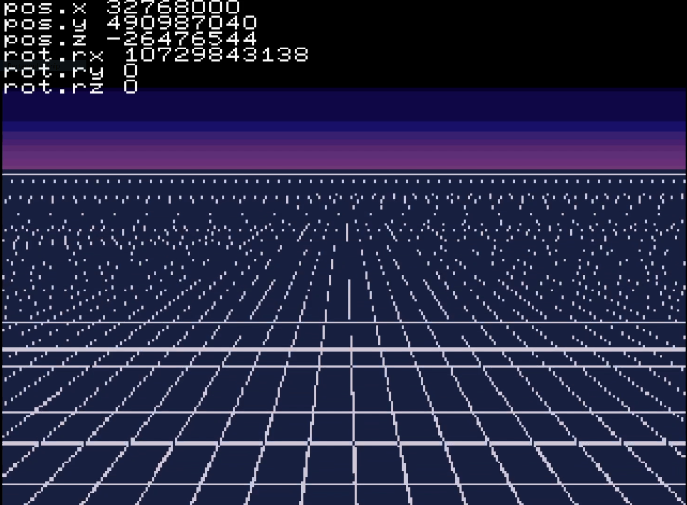
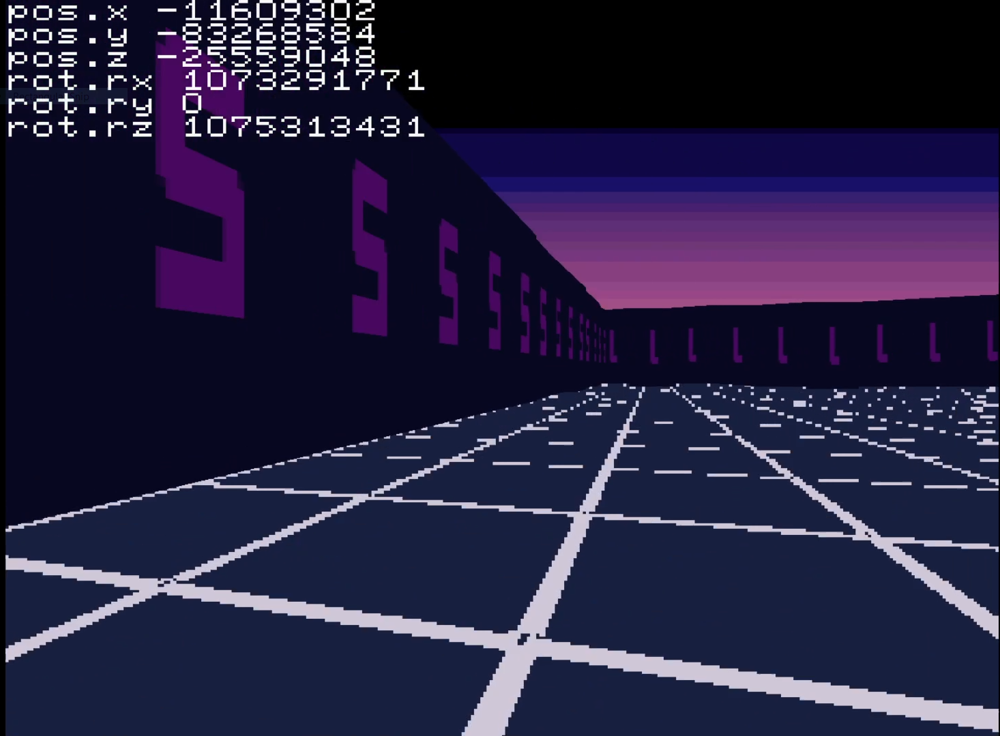
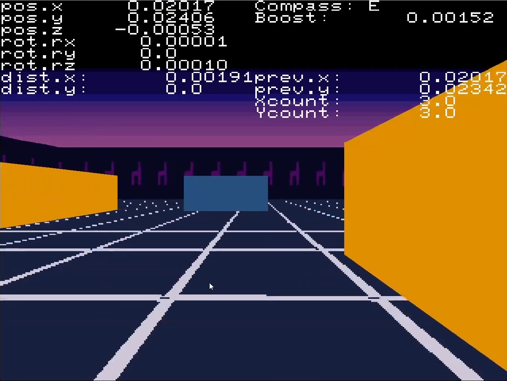
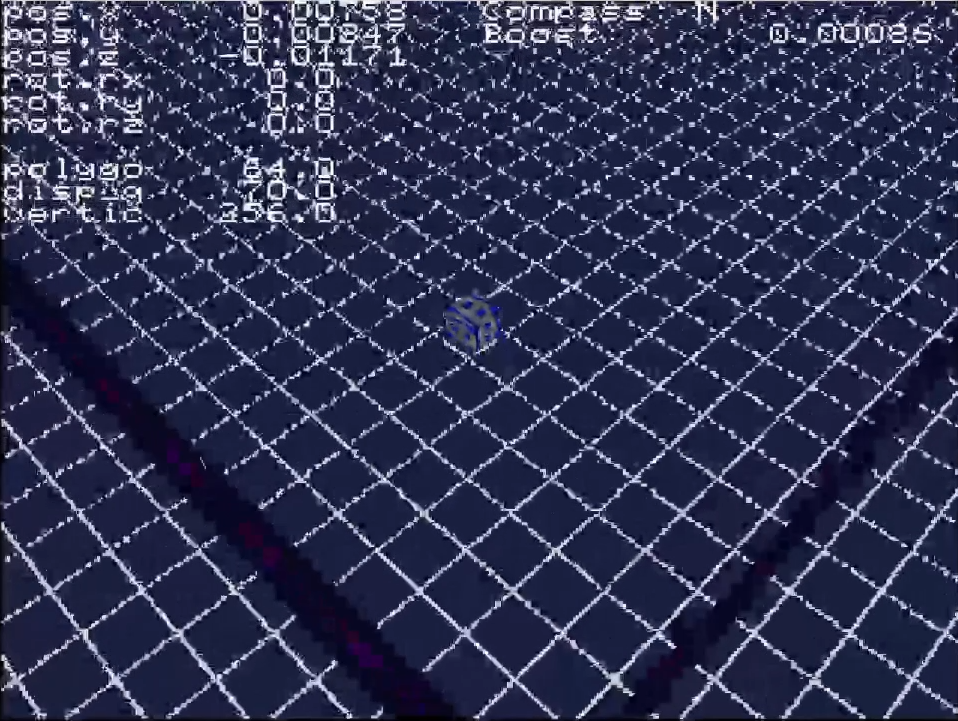

# Circuit Breaker

Sega Saturn homebrew game built with jo-engine.

You're the Saturn's forgotten second CPU, waking up and fighting your way out of the console:
see [the story](./docs/STORY.md).

## Development Images

**Note: This image is bad quality due to video compression when capturing gameplay.**
 

## Development Videos

1. [Circuit Breaker - Sega Saturn Development - 1](https://www.youtube.com/watch?v=tnn5bpHUiHg)
2. [Speed boost & gradual turning & walls - Circuit Breaker - Sega Saturn Development - 2](https://www.youtube.com/watch?v=vwfhMTDOESk)
3. [Buggy Trails - Circuit Breaker - Saturn Development 3](https://www.youtube.com/watch?v=p6P8kDKgvIU)
4. [Switching between perspectives - Circuit Breaker - Saturn Development 4](https://www.youtube.com/watch?v=hHe3XTwqL-g)
5. [3rd Person Upgrades - Circuit Breaker Saturn dev 5](https://www.youtube.com/watch?v=FrBi1BjDjkE/edit)

## How to run

1. Place within a folder under jo-engine's 'Projects' folder.
2. Compile and run the game: `./run.sh`

## Tests

Game logic that doesn't depend on the Saturn (`src/game/`: cycle movement and light-cycle trails) is plain C and unit-tested on the PC:

- Windows: `tests\run_tests.bat` (uses gcc if it's on PATH, otherwise Visual Studio's `cl`)
- Linux/macOS: `./tests/run_tests.sh`

### End-to-end (in Docker, no screen needed)

`tests\e2e\run_e2e.ps1` boots the built `game.cue` in Mednafen inside a Linux container (virtual screen via Xvfb),
presses pad buttons from a step script and saves screenshots to `tests/build/e2e/`.

- Needs Docker and a Saturn BIOS (defaults to `Emulators/YabaSanshiro/bios.bin`; it is mounted, never copied into the image).
- Steps live in `tests/e2e/*.steps`: `wait`, `press`, `hold` and `shot` (see `tests/e2e/run.sh`).
- `level_bounds.steps` checks the arena boundary, the Y toggle and the debug camera height limits.

## Performance

The debug text shows `fps` and `cpu`/`peak`: the master SH-2's time for game logic and 3D setup as a % of one frame.
To measure the worst case from boot, build with `make re _CCFLAGS=-DPERF_STRESS_TRAIL` (fills the trail at start).

## Controls

- Left / Right: turn 90°
- Up: boost
- Down: switch between isometric and 1st person view
- A: clear the trail
- Y: arena boundary on/off (debug: lets the cycle leave the arena)
- L / R: arena smaller / larger (tuning; the debug text shows the width)
- B / C: cruise speed down / up (tuning; units per frame)
- X: fill the trail with a full-length zig-zag (worst case, for performance checks)
- Start: debug camera (D-pad pans, L/R height, B/C pitch)
