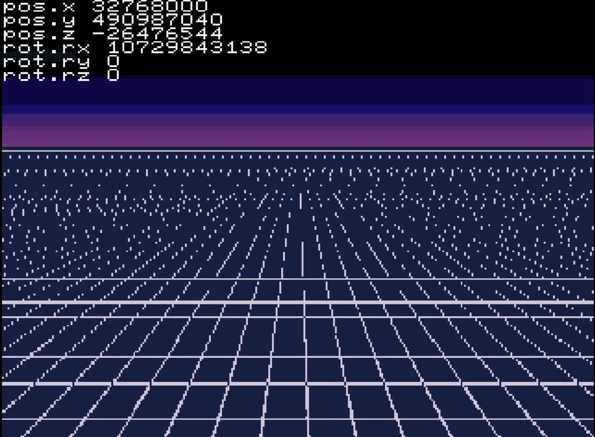
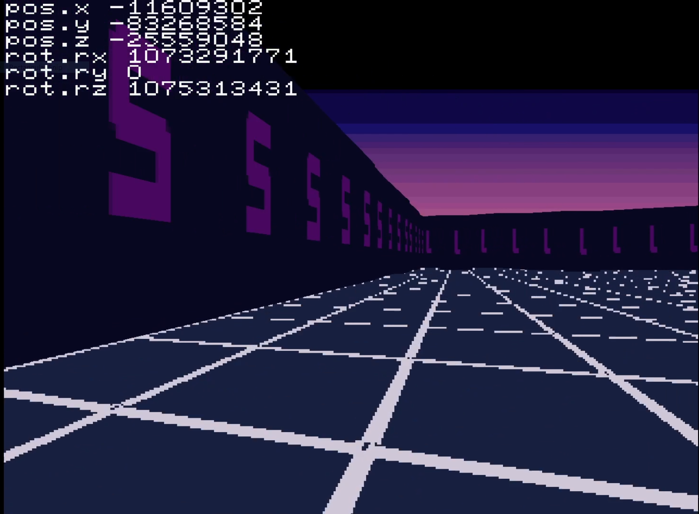
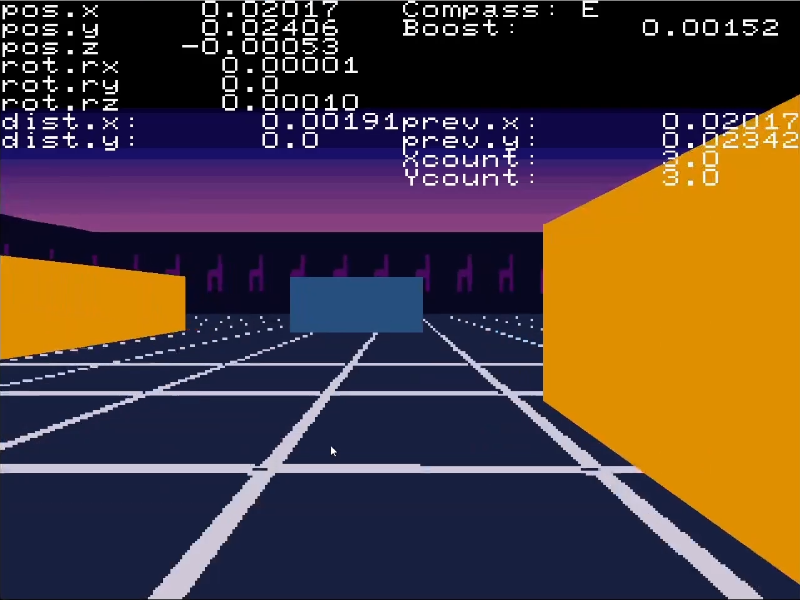
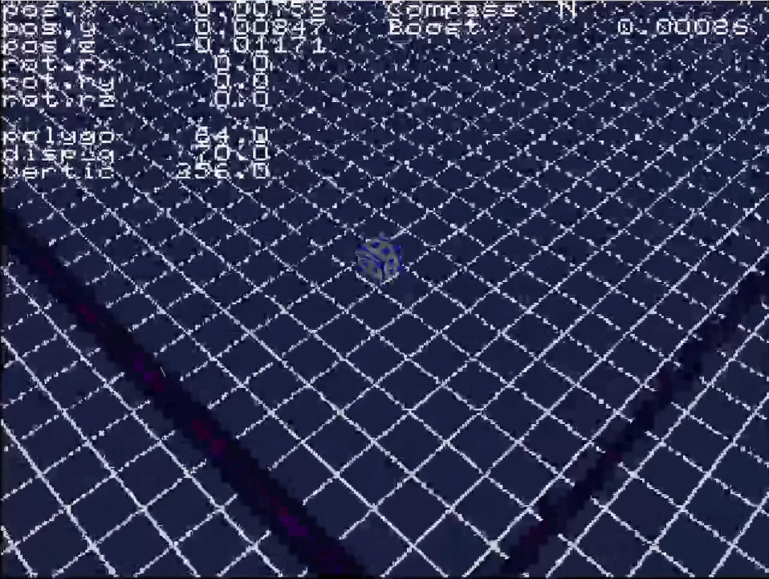

# Circuit Breaker

Sega Saturn homebrew game built with jo-engine.

You're the Saturn's forgotten second CPU, waking up and fighting your way out of the console:
see [the story](./docs/STORY.md).

## Development Images

**Note: This image is bad quality due to video compression when capturing gameplay.**
 

## Development Videos

1. [Circuit Breaker - Sega Saturn Development - 1](https://www.youtube.com/watch?v=tnn5bpHUiHg)
2. [Speed boost & gradual turning & walls - Circuit Breaker - Sega Saturn Development - 2](https://www.youtube.com/watch?v=vwfhMTDOESk)
3. [Buggy Trails - Circuit Breaker - Saturn Development 3](https://www.youtube.com/watch?v=p6P8kDKgvIU)
4. [Switching between perspectives - Circuit Breaker - Saturn Development 4](https://www.youtube.com/watch?v=hHe3XTwqL-g)
5. [3rd Person Upgrades - Circuit Breaker Saturn dev 5](https://www.youtube.com/watch?v=FrBi1BjDjkE/edit)

## How to run

1. Place within a folder under jo-engine's 'Projects' folder.
2. Compile and run the game: `./run.sh`

## Tests

Game logic that doesn't depend on the Saturn (`src/game/`: cycle movement and light-cycle trails) is plain C and unit-tested on the PC:

- Windows: `tests\run_tests.bat` (uses gcc if it's on PATH, otherwise Visual Studio's `cl`)
- Linux/macOS: `./tests/run_tests.sh`

### End-to-end (in Docker, no screen needed)

`tests\e2e\run_e2e.ps1` boots the built `game.cue` in Mednafen inside a Linux container (virtual screen via Xvfb),
presses pad buttons from a step script and saves screenshots to `tests/build/e2e/`.

- Needs Docker and a Saturn BIOS (defaults to `Emulators/YabaSanshiro/bios.bin`; it is mounted, never copied into the image).
- Steps live in `tests/e2e/*.steps`: `wait`, `press`, `hold` and `shot` (see `tests/e2e/run.sh`).
- The game boots into the opening flight: scripts that test play start with `skip_prologue`, which jumps to play once it's booted. `intro.steps` films the flight; `intro_gif.steps` does it in slow motion for a GIF.
- `level_bounds.steps` checks the arena boundary, the Y toggle and the debug camera height limits.

## Performance

The debug text (top left; none on the spectator view) shows `fps` (each frame timed by the SH-2's free running counter), `cpu`/`pk` (the master SH-2's time for game logic and 3D setup as a % of one frame) and `late` (vblanks missed since boot). High `late` with low `cpu` means VDP1 is the bottleneck.

The game steps once per vblank whatever the frame rate: a frame that takes two vblanks is followed by two game steps, so a slowdown shows as choppier motion, not slower play.
To measure the worst case from boot, build with `make re _CCFLAGS=-DPERF_STRESS_TRAIL` (fills the trail at start).

## Controls

- Left / Right: turn 90°
- Up: boost
- Down: switch between isometric and 1st person view
- L / R (hold): look left / right (1st person)
- A: the bots' difficulty: Easy, Medium, Hard (a toggle for now; the status line says which, the debug text's last line shows E / M / H). Rounds 4 and 5 are at least Medium whatever's picked
- Y: arena boundary on/off (debug: lets the cycle leave the arena)
- B / C: cruise speed down / up (tuning; units per frame)
- X: fill the trail with a full-length zig-zag (worst case, for performance checks)
- Start: debug camera (D-pad pans, L/R height, B/C pitch, X / Y arena smaller / larger: tuning, the debug text shows the width; Z: a crash only stops the cycle instead of terminating the player, "NOTERM" in the debug text, for testing; A: jump to the next part of the game, intro flight -> spectator loop -> play -> intro, when you leave the debug camera)
- The game boots into the opening flight (`BOOT_SCENE` in `src/input.c`: set it to `SCENE_LOOP` or `SCENE_PLAY` to boot into a later part). During the flight, the first press of any button but START and Z runs it at x3 (once: later presses do nothing); once it has landed, a direction is a hit on the loop, and the third breaks it: the camera flies down from the stands (an overview of the arena as its walls rise) into the cycle at its start in 3 s, and play begins. The loop's cycle boosts all the way. A debug line shows the flight's segment (the opening flight's, or `ARRIVE` and the walls' rise for the flight down), frame and speed, and where the cycle and camera are (`SHOW_FLIGHT_DEBUG` in `main.c`)
